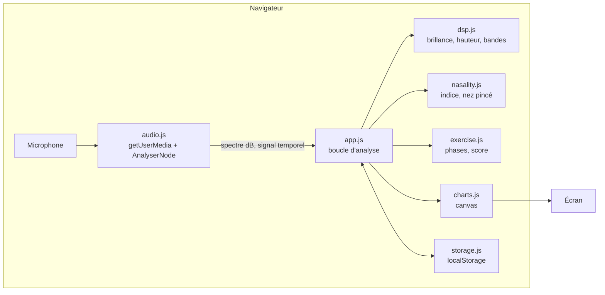

# Architecture de Twang Perfect

## Vue d'ensemble

Twang Perfect est une application web statique : deux pages HTML, une feuille de style, sept modules JavaScript natifs (ES modules). Il n'y a ni serveur applicatif, ni dépendance, ni étape de construction. Tout le calcul se fait dans le navigateur, sur le fil principal, une fois par image affichée.

Le principe d'organisation est une séparation en trois couches :

1. **Calcul pur** (`dsp.js`, `nasality.js`, `exercise.js`) : des fonctions sans accès au navigateur. Elles reçoivent des nombres et des tableaux et renvoient des nombres. Elles sont testées sous Node.
2. **Bords du système** (`audio.js`, `storage.js`, `charts.js`) : micro, stockage local, canvas. Chaque module ne touche qu'une seule interface du navigateur.
3. **Orchestration** (`app.js`) : l'état, la boucle d'analyse, les événements et l'affichage.



Les flèches partent de `app.js` : aucun module de calcul n'en importe un autre, sauf `nasality.js`, qui réutilise quatre fonctions vectorielles de `dsp.js`.

## Modules

| Module | Rôle | Dépend de | Testé |
|---|---|---|---|
| `js/dsp.js` | Puissance par bande, brillance, niveau, statistiques, normalisation, lissage, bandes en tiers d'octave, projection, détection de hauteur, nom de note | — | oui |
| `js/nasality.js` | Indice de nasalité, comparaison du test du nez pincé, seuils | `dsp.js` | oui |
| `js/exercise.js` | Phase d'un essai, score, statistiques d'historique | — | oui |
| `js/audio.js` | Vérification du contexte sécurisé, ouverture du micro, messages d'erreur | Web Audio, MediaDevices | non |
| `js/storage.js` | État par défaut, chargement, enregistrement, export JSON | localStorage | non |
| `js/charts.js` | Trace roulante, ligne de séance, historique | Canvas 2D | non |
| `js/app.js` | État, boucle, captures, essais, affichage | tous | parcours manuel |

## Chaîne de mesure

À chaque image (`requestAnimationFrame`), `app.js` exécute la séquence suivante.

1. **Acquisition.** `AnalyserNode` fournit le spectre en dB (`getFloatFrequencyData`, FFT de 4 096 points, lissage interne désactivé) et le signal temporel (`getFloatTimeDomainData`). À 48 kHz, la résolution est de 11,7 Hz par case.
2. **Niveau.** `rmsDb` calcule le niveau efficace du bloc.
3. **Hauteur.** Une image sur quatre, `detectPitch` calcule l'autocorrélation normalisée des 2 048 derniers échantillons, entre 70 et 1 000 Hz. Il renvoie la fréquence et une « clarté » entre 0 et 1.
4. **Décision de voisement.** Une image est analysée si le niveau dépasse le seuil **et** si la clarté atteint 0,5. Le seuil vaut le bruit ambiant médian mesuré pendant une seconde, plus 10 dB, borné entre −65 et −25 dB.
5. **Brillance.** `brightnessDb` = 10·log10(puissance entre 2 500 et 4 000 Hz / puissance entre 80 et 8 000 Hz). C'est un rapport : il ne dépend pas du volume.
6. **Lissage.** `ema` applique un lissage exponentiel de constante 80 ms, calculé à partir du temps écoulé et non du nombre d'images.
7. **Normalisation.** `normalize` place la brillance lissée entre la voix neutre (0) et le twang de référence (1), avec un plafond à 1,2.
8. **Formes de spectre.** `bandLevels` calcule deux vecteurs de niveaux en tiers d'octave, recentrés sur leur moyenne : 200–1 500 Hz pour l'indice de nasalité, 200–4 000 Hz pour le test du nez pincé.

Une image non voisée produit la valeur `null`. Les courbes s'interrompent alors au lieu de tomber à zéro, et le lissage repart de la valeur suivante.

## Calibration

Une capture dure 2,5 secondes après un décompte. Elle est rejetée si la voix a été détectée moins d'une seconde. Elle se résume ainsi : médiane de la brillance, moyenne des vecteurs de bandes, médiane de la hauteur.

| Repère | Contenu enregistré | Contrôle |
|---|---|---|
| Voix neutre | brillance, vecteur 200–1 500 Hz, hauteur | efface la prise twang si elle n'est plus au-dessus |
| Voix twang | idem | refusée si l'écart est de 0,5 dB ou moins ; alerte sous 3 dB ; alerte si la note diffère de plus de 2 demi-tons |
| Voix nasale volontaire (facultatif) | vecteur 200–1 500 Hz, hauteur | alerte si elle est à moins de 1 dB de la référence orale |

## Nasalité

### Test du nez pincé (`comparePinch`)

Deux prises de 2,5 secondes : nez libre, puis nez pincé.

- **Écart** : moyenne des écarts absolus entre les deux vecteurs moyens (200–4 000 Hz), en dB.
- **Plancher** : variation interne de chaque prise (première moitié contre seconde moitié), moyennée sur les deux prises, avec un minimum de 0,5 dB.
- **Verdict** : « changé » si l'écart vaut au moins deux fois le plancher et au moins 1,5 dB ; « inchangé » si l'écart vaut moins de 1,3 fois le plancher ; « incertain » sinon.

Le test repose sur un fait physique : boucher les narines ne modifie le son que s'il passe par le nez. Les seuils sont empiriques.

### Indice continu (`nasalIndex`)

Le vecteur courant est projeté sur la droite qui relie la référence orale (moyenne des prises neutre et twang) à la référence nasale. La position sur la droite donne l'indice, borné entre 0 et 1. La distance à la droite, rapportée à l'écart entre les références, donne un résidu : au-delà de 1, l'interface affiche « hors modèle ». La dispersion affichée (±) est l'écart-type de l'indice sur les 600 dernières millisecondes.

## Exercice

Un essai est un objet `{ startAt, durationMs, lo, hi, blind, samples }`. `trialPhase` en déduit la phase à partir de l'heure : décompte de 3 secondes, essai, fin. Pendant l'essai, chaque image voisée ajoute `{ v, dt }`. `scoreTrial` additionne les durées passées dans la cible et les rapporte à la durée de l'essai.

Avec l'option de retour masqué, la jauge et les deux courbes sont cachées pendant l'essai. Seuls la barre d'état et le compte à rebours restent visibles.

## État et persistance

L'état tient dans un seul objet, enregistré sous la clé `twangPerfect.v1` :

```json
{
  "version": 1,
  "band": { "twangLo": 2500, "twangHi": 4000 },
  "calibration": { "neutral": null, "twang": null, "nasal": null },
  "settings": { "lo": 60, "hi": 100, "durationS": 8, "blind": false },
  "history": []
}
```

L'historique est limité aux 500 derniers essais. Le chargement fusionne l'état enregistré avec l'état par défaut, ce qui tolère l'ajout de champs. Un stockage refusé (navigation privée, quota) ne bloque pas l'outil : l'essai s'affiche et un message signale qu'il n'est pas enregistré.

Le stockage local est lié à l'origine : un historique créé sur `localhost` n'est pas visible sur l'adresse GitHub Pages. L'export JSON sert de sauvegarde ; l'import n'est pas implémenté.

## Affichage

| Vue | Horizon | Données |
|---|---|---|
| Jauge | instant | brillance normalisée, zone cible, trait à 100 % |
| Trace roulante | 15 secondes | points horodatés, un par image |
| Ligne de séance | depuis l'activation du micro | un point toutes les 200 ms ; au-delà de 6 000 points, un point sur deux est conservé et le pas double |
| Historique | 30 derniers essais | un bâton par essai |

Les axes verticaux des deux courbes vont de 0 à 120 % et ne sont jamais recadrés.

## Décisions de conception

| Décision | Raison | Alternative écartée |
|---|---|---|
| JavaScript natif, sans construction | Le micro en temps réel dans une page web impose JavaScript ; l'absence de construction permet l'hébergement statique et la lecture directe du code | Python côté serveur : latence, pas d'hébergement statique |
| `AnalyserNode` plutôt qu'`AudioWorklet` | L'affichage se rafraîchit au rythme de l'écran ; un traitement à l'échantillon n'apporte rien | `AudioWorklet` : plus de code, même résultat visible |
| Brillance en dB | Un écart en dB correspond mieux à la perception qu'un rapport linéaire, et la normalisation entre deux repères reste régulière | Rapport linéaire : jauge écrasée vers le bas |
| Mesures relatives à la personne | Un seuil absolu de brillance dépend du micro, de la voyelle et de la voix | Seuils universels : faux pour presque tout le monde |
| Nasalité par référence personnelle | Les mesures publiées varient selon la voyelle et le locuteur, et demandent un suivi des formants peu robuste en voix chantée | Bandes fixes : hypothèse non étayée |
| Score rapporté à la durée de l'essai | L'objectif est de tenir ; se taire ne doit rien rapporter | Part du temps voisé : un seul bon instant donnait 100 % |

## Ce qui n'est pas couvert

- Aucun test automatique de l'interface, du micro ou du stockage dans le dépôt.
- Aucune validation sur voix réelle ni comparaison à une mesure de référence (nasomètre, électroglottographie).
- Navigateurs autres que Chrome 153 non vérifiés.
- Pas de mode hors ligne (service worker), pas d'import de données.
